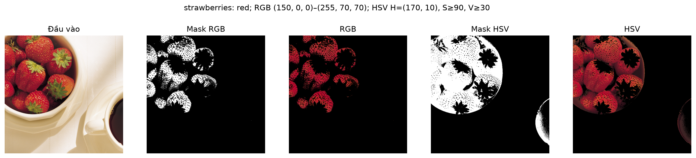
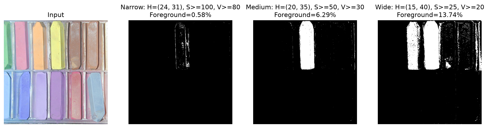
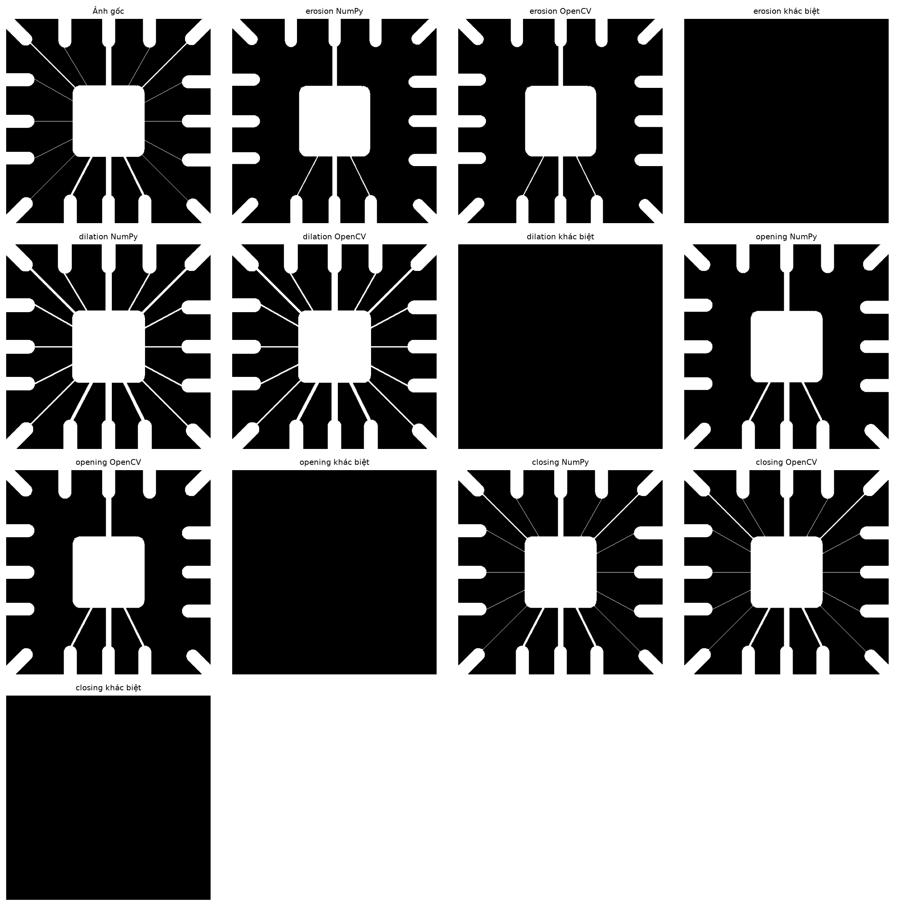
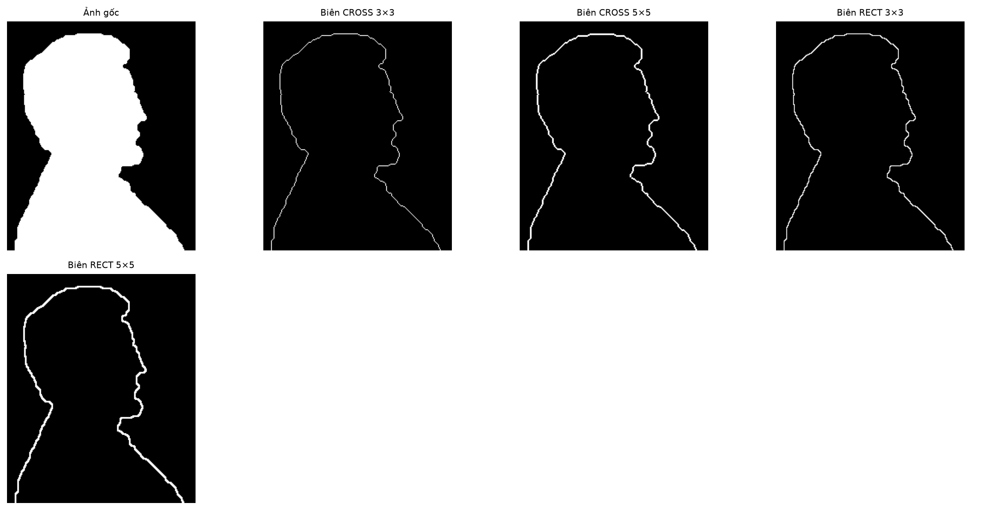
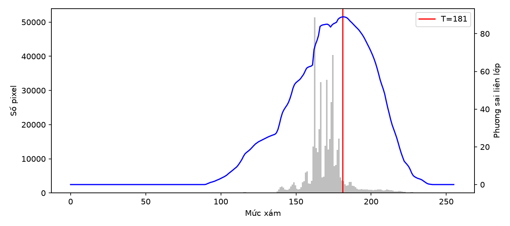
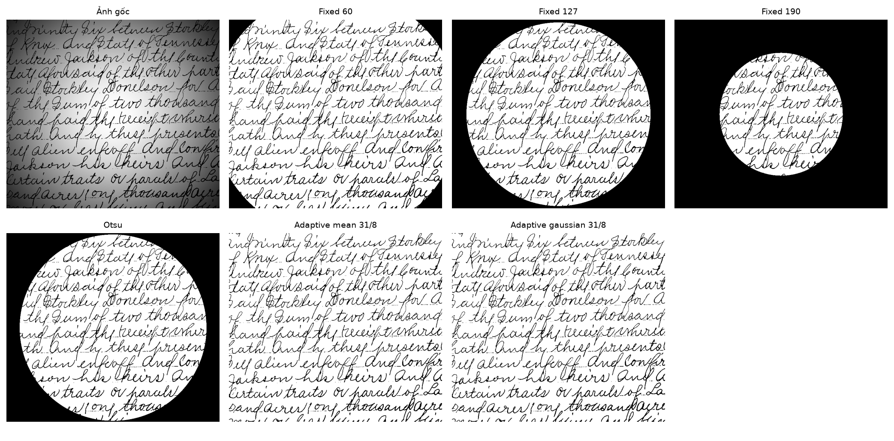
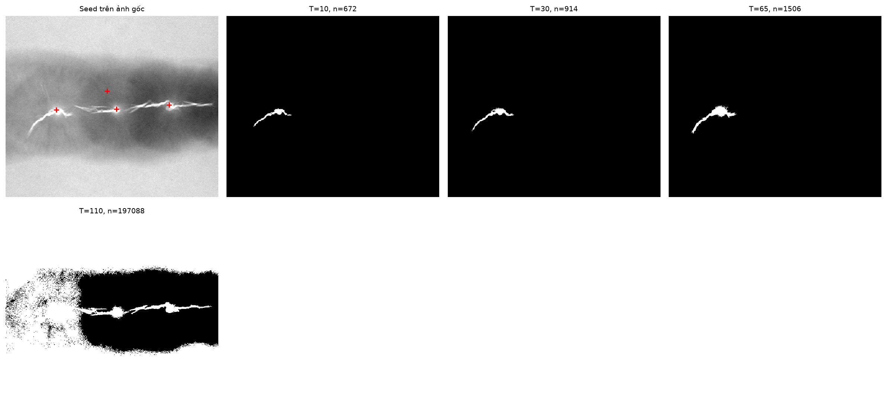
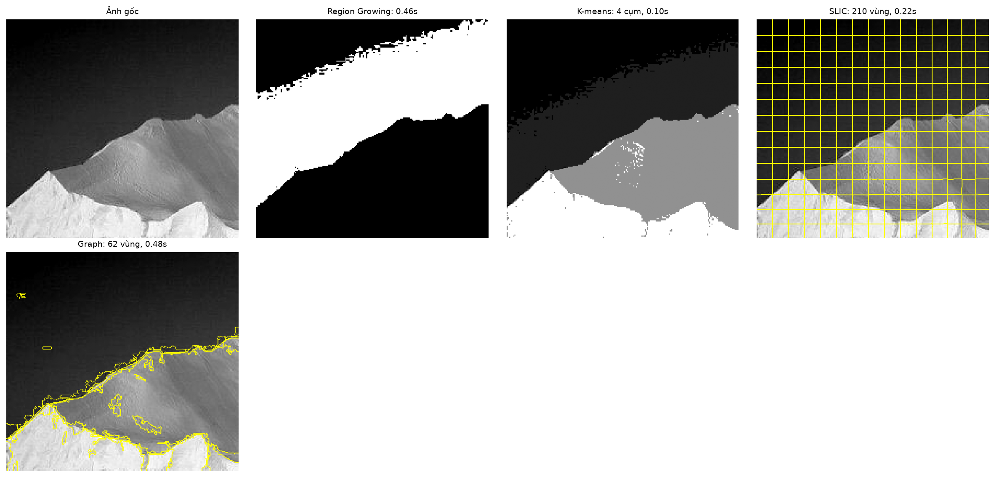

# Bài Thực Hành 2 — Xử Lý Ảnh Số (Digital Image Processing)

- **Môn học:** Xử lý ảnh số (Digital Image Processing)
- **Sinh viên thực hiện:** Phạm Mạnh Dũng
- **Mã sinh viên:** B23DCCE024
- **Lớp:** E23TTNT02
- **Dữ liệu thực nghiệm:** Bộ ảnh chuẩn giáo trình _Digital Image Processing (Gonzalez & Woods)_

---

## 1. Cấu Trúc Dự Án (Các File & Thư Mục Quan Trọng)

```text
dip-th2/
├── data/
├── src/
│   ├── color_utils.py
│   ├── morphology.py
│   ├── edge_and_threshold.py
│   ├── region_segmentation.py
│   └── visualization.py
├── notebooks/
├── outputs/
├── docs/
│   ├── BAO_CAO_THUC_HANH_2.md
│   ├── planning/
│   └── resources/
└── environment.yml
```

---

## 2. Hướng Dẫn Cài Đặt Môi Trường & Chạy

### 2.1. Cài đặt môi trường Conda

Dự án sử dụng môi trường Conda `dip-th2` chạy trên **Python 3.11**:

```bash
# Cách 1: Khởi tạo tự động từ file environment.yml
conda env create -f environment.yml
conda activate dip-th2

# Cách 2: Khởi tạo thủ công bằng lệnh pip trong môi trường Python 3.11
conda create -n dip-th2 python=3.11 -y
conda activate dip-th2
pip install numpy scipy matplotlib pillow opencv-python scikit-image ipykernel jupyter
```

### 2.2. Chạy thực nghiệm

#### A. Chạy bằng Jupyter Notebook / VS Code

1. Khởi động Jupyter Lab hoặc mở thư mục dự án trong VS Code / Antigravity IDE:
   ```bash
   jupyter lab
   ```
2. Chọn Kernel thực thi là môi trường **`dip-th2`**.
3. Chạy tuần tự các Notebook trong thư mục `notebooks/`:
   - `notebooks/bai_1_phan_doan_anh_mau.ipynb`
   - `notebooks/bai_2_hinh_thai_hoc.ipynb`
   - `notebooks/bai_3_phat_hien_bien_phan_nguong.ipynb`
   - `notebooks/bai_4_phan_doan_vung.ipynb`

Toàn bộ hình ảnh kết quả và bảng số liệu CSV sẽ được tự động xuất ra thư mục `outputs/bai_X/`.

#### B. Sử dụng trực tiếp các hàm thuật toán từ thư mục `src/`

Các thuật toán cốt lõi được đóng gói hoàn chỉnh trong `src/` và có thể import trực tiếp:

```python
from src.color_utils import rgb_to_hsi, segment_color_hsv
from src.morphology import my_erosion, my_dilation, boundary_extraction, hole_filling
from src.edge_and_threshold import my_otsu_threshold, compute_sobel, zero_crossing
from src.region_segmentation import my_region_growing, run_kmeans_segmentation
```

---

## 3. Các Kết Quả Chạy Chính & Ví Dụ Đầu Ra

### Bài 1. Phân Tích và Phân Đoạn Ảnh Màu

- **Chuyển đổi không gian màu:** Chuyển đổi thành công sang HSV, CIELAB và tự lập trình chuyển đổi sang HSI bằng NumPy theo chuẩn Gonzalez & Woods.
- **Phân đoạn đối tượng theo màu:**
  - Đối tượng dâu đỏ: Tách biệt trọn vẹn bằng kênh Hue trong HSV (xử lý quấn mốc $0^\circ / 180^\circ$), vượt trội so với RGB khi xuất hiện bóng râm và đốm chói.
  - Khảo sát 3 bộ ngưỡng dâu đỏ: Ngưỡng Hẹp (RGB: 0,30%, HSV: 11,00%), Vừa (RGB: 13,02%, HSV: 25,09%), Rộng (RGB: 23,41%, HSV: 69,09%).

|                                                    Ví dụ đầu ra Bài 1                                                    |
| :----------------------------------------------------------------------------------------------------------------------: |
|  |
|                         _Hình 1: Đối sánh phân đoạn nhóm quả dâu đỏ giữa không gian RGB và HSV._                         |
|       |
|               _Hình 2: Khảo sát 3 bộ ngưỡng (Hẹp - Vừa - Rộng) phân đoạn phấn vàng trong không gian HSV._                |

---

### Bài 2. Xử Lý Ảnh Hình Thái Học (Morphology)

- **Kiểm chứng thuật toán tự lập trình:** Các hàm `my_erosion`, `my_dilation`, `my_opening`, `my_closing` viết thuần NumPy đạt **sai số 0 pixel** (Max Error = 0) so với hàm chuẩn của OpenCV (`cv2.erode`, `cv2.dilate`).
- **Phần tử cấu trúc (SE):** Khảo sát các hình dạng `RECT`, `CROSS`, `ELLIPSE` với các kích thước $3\times3 \dots 45\times45$, kiểm chứng quy luật triệt tiêu chi tiết và hàn gắn nét đứt gãy.
- **Thuật toán nâng cao:** Thực hiện trích xuất đường biên $\beta(A) = A - (A \ominus B)$ trên ảnh Lincoln và làm đầy lỗ thủng (Hole Filling) bằng lan truyền BFS đạt kết quả trùng khớp 100% với `scipy.ndimage.binary_fill_holes`.

|                                                   Ví dụ đầu ra Bài 2                                                   |
| :--------------------------------------------------------------------------------------------------------------------: |
|                      |
|  _Hình 3: Đối chiếu kết quả 4 phép toán giữa NumPy tự viết và OpenCV trên ảnh mạch wirebond (sai số tuyệt đối = 0)._   |
|  |
|                      _Hình 4: Trích xuất đường biên Lincoln với các phần tử cấu trúc khác nhau._                       |

---

### Bài 3. Phát Hiện Biên và Phân Ngưỡng

- **Phát hiện biên:** Khảo sát Sobel (chuẩn hóa độ lợi theo $k$), Laplacian & LoG zero-crossing, và Canny (làm trơn Gaussian trước khi chạy ngưỡng trễ).
- **Phân ngưỡng Otsu:** Hàm `my_otsu_threshold` tự lập trình tìm chính xác ngưỡng cực đại hóa phương sai liên lớp $T^* = 181$ trên ảnh `polymersomes`, khớp 100% với `cv2.THRESH_OTSU` và `skimage.filters.threshold_otsu`.
- **Phân ngưỡng thích nghi (Adaptive):** Minh chứng sự thất bại của ngưỡng toàn cục (Fixed, Otsu) trên ảnh chiếu sáng không đồng đều (`spot_shaded_text_image`) và sự phục hồi chữ sắc nét của Adaptive Gaussian ($C=8, \text{block}=31$).
- **Khảo sát nhiễu:** Khi độ lệch chuẩn nhiễu tăng ($\sigma = 0 \to 10 \to 50$), Laplacian vỡ nát hoàn toàn, Sobel sinh nhiều biên giả, trong khi Canny bền vững nhất. Tiền xử lý lọc Gaussian/Median khôi phục lại 2 đỉnh Histogram giúp Otsu đạt IoU cao.

|                                                         Ví dụ đầu ra Bài 3                                                         |
| :--------------------------------------------------------------------------------------------------------------------------------: |
|                                    |
|   _Hình 5: Biểu đồ phân bố mức xám và đường cong phương sai liên lớp $\sigma_B^2(k)$ xác định ngưỡng Otsu tối ưu $T^_ = 181$.\*    |
|  |
|       _Hình 6: Đối chiếu phân ngưỡng cố định, Otsu toàn cục và Adaptive Thresholding trên ảnh có bóng chiếu sáng không đều._       |

---

### Bài 4. Phân Đoạn Ảnh Dựa Trên Vùng

- **Region Growing (Tự lập trình BFS):** Khảo sát vị trí hạt giống và ngưỡng đồng nhất $T$ trên ảnh khuyết tật mối hàn (`defective_weld`). Ngưỡng $T=30$ bám khít vết nứt ($n=2647$ pixel), trong khi $T=110$ gây rò rỉ vùng lan ra toàn bộ nền ($n=120.250$ pixel).
- **K-Means & SLIC Superpixels:**
  - K-Means ($K=2, 3, 4, 5$): Tách dần từ sáng/tối thô sơ sang các vùng ngữ nghĩa chi tiết (quả dâu, cuống lá xanh, nền, vùng phản xạ chói).
  - SLIC Superpixels: Khảo sát số vùng $n \in \{60, 200, 500\}$ và độ đặc $m \in \{1, 10, 40\}$. Độ đặc nhỏ ($m=1$) bám biên mềm dẻo; độ đặc lớn ($m=40$) tạo các siêu điểm ảnh đồng đều dạng tổ ong.
- **So sánh đa phương pháp:** Đối chiếu định tính và thời gian thực thi giữa Region Growing, K-Means, SLIC và Graph-based (Felzenszwalb) trên cùng ảnh tảng băng trôi (`iceberg`).

|                                                  Ví dụ đầu ra Bài 4                                                   |
| :-------------------------------------------------------------------------------------------------------------------: |
|      |
|      _Hình 7: Khảo sát ngưỡng đồng nhất $T \in \{10, 30, 65, 110\}$ trong Region Growing tách vết nứt mối hàn._       |
|      |
| _Hình 8: So sánh trực quan và thời gian thực thi giữa Region Growing, K-Means, SLIC và Graph-based trên ảnh iceberg._ |

---

## 4. Tài Liệu Báo Cáo Chi Tiết

Để xem toàn bộ phân tích lý thuyết, bảng số liệu định lượng, nhận xét học thuật và minh chứng thực hiện trên môi trường cá nhân, vui lòng tham khảo:
**[Báo Cáo Thực Hành 2 (Markdown)](docs/BAO_CAO_THUC_HANH_2.md)**
