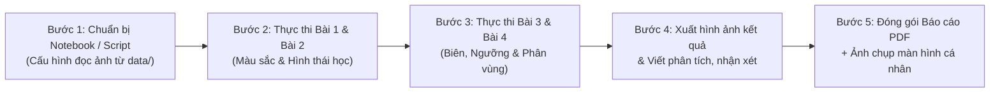

# Tài Liệu Tổng Hợp & Phân Tích Đề Bài Thực Hành 2 — Xử Lý Ảnh Số (Digital Image Processing)

> **Hạn nộp (Deadline):** Trước Thứ Năm, ngày **05/11/2026**

> **Hình thức nộp:** Báo cáo PDF (kèm mã nguồn, ảnh đầu vào/đầu ra, tham số, nhận xét, so sánh kết quả và ảnh chụp màn hình minh chứng cá nhân) + chia sẻ quyền truy cập/tải xuống trên LMS.

---

## 1. Tổng Quan Bài Thực Hành

### 1.1. Mục tiêu

Bài thực hành số 2 tập trung vào các kỹ thuật trung gian và nâng cao trong chuỗi xử lý ảnh số (theo giáo trình _Digital Image Processing, 3rd Edition — Gonzalez & Woods_, các chương 6, 9 và 10):

1. **Bài 1 — Xử lý và phân đoạn ảnh màu (Chương 6):** Hiểu bản chất các không gian màu (RGB, HSV/HSI, CIELAB) và cách tách đối tượng dựa trên đặc trưng màu sắc.
2. **Bài 2 — Xử lý ảnh hình thái học (Chương 9):** Nắm vững toán tử hình thái học cơ bản thông qua việc tự cài đặt bằng NumPy và ứng dụng trích xuất đặc trưng hình học trên ảnh nhị phân.
3. **Bài 3 — Phát hiện biên và phân ngưỡng (Chương 10 - Phần 1):** Khảo sát đạo hàm bậc 1, bậc 2, thuật toán Canny và các phương pháp phân ngưỡng tự động (Otsu, Adaptive) trong điều kiện ảnh sạch và ảnh nhiễu.
4. **Bài 4 — Phân đoạn ảnh dựa trên vùng và đồ thị (Chương 10 - Phần 2):** Kết hợp thông tin không gian và cường độ sáng/màu sắc để gom nhóm điểm ảnh (Region Growing, K-means, SLIC Superpixels, Graph-based/Split & Merge).

### 1.2. Công cụ & Thư viện chuẩn bị

| Thư viện                             | Vai trò chính trong bài thực hành                                                                                                                                     |
| :----------------------------------- | :-------------------------------------------------------------------------------------------------------------------------------------------------------------------- |
| **NumPy (`numpy`)**                  | Thao tác mảng đa chiều, tự cài đặt các thuật toán từ đầu (Morphology, Otsu, Region Growing, HSI conversion).                                                          |
| **OpenCV (`cv2`)**                   | Đọc/ghi ảnh, chuyển đổi không gian màu, đối chiếu kết quả hình thái học, phát hiện biên (Sobel, Laplacian, Canny), phân ngưỡng và phân cụm.                           |
| **scikit-image (`skimage`)**         | Cung cấp các thuật toán nâng cao: `slic`, `felzenszwalb` (graph-based), `rag_mean_color` / `cut_normalized` (graph cuts), `thin`, `skeletonize`, `convex_hull_image`. |
| **Matplotlib (`matplotlib.pyplot`)** | Hiển thị lưới ảnh đối sánh, vẽ biểu đồ Histogram và đường biên phân đoạn.                                                                                             |

### 1.3. Quy chuẩn bắt buộc cho mỗi mục thực nghiệm

Để đạt điểm tối đa, mỗi yêu cầu nhỏ trong từng bài đều phải trình bày đủ **5 thành phần**:

1. **Ảnh đầu vào (Input):** Nêu rõ tên file trong bộ dữ liệu `data/` và kích thước/đặc điểm của ảnh.
2. **Mã nguồn (Source Code):** Rõ ràng, có chú thích các bước xử lý chính.
3. **Tham số thực nghiệm (Parameters):** Liệt kê cụ thể các bộ tham số đã khảo sát (ví dụ: kích thước kernel, ngưỡng $T$, số cụm $K$, $\sigma$, v.v.).
4. **Ảnh kết quả (Output):** Trình bày trực quan theo lưới (subplot) để dễ đối chiếu.
5. **Nhận xét & So sánh (Analysis):** Giải thích **tại sao** kết quả thay đổi khi đổi tham số hoặc đổi phương pháp, ưu/nhược điểm và tốc độ thực thi (nếu tự code so với thư viện).

---

## 2. Các Khái Niệm và Kiến Thức Lý Thuyết Liên Quan

### 2.1. Không gian màu và Phân đoạn ảnh màu (Bài 1)

#### a) Các không gian màu

- **RGB (Red - Green - Blue):**
  - Không gian màu cộng dựa trên phần cứng thu/phát.
  - **Hạn chế trong phân đoạn:** Thông tin màu sắc (chrominance) và độ sáng (luminance) bị trộn lẫn trên cả 3 kênh $R, G, B$. Khi ánh sáng môi trường thay đổi hoặc có bóng đổ, giá trị cả 3 kênh đều biến thiên mạnh khiến việc đặt ngưỡng hình hộp chữ nhật trong RGB rất khó chính xác.
- **HSV (Hue - Saturation - Value) & HSI (Hue - Saturation - Intensity):**
  - Tách biệt thành phần màu sắc thuần túy (**Hue** — góc màu từ $0^\circ \to 360^\circ$), độ bão hòa (**Saturation** — độ tinh khiết của màu) và độ sáng (**Value / Intensity**).
  - **Công thức chuyển đổi chuẩn từ RGB chuẩn hóa $[0, 1]$ sang HSI (Gonzalez & Woods):**
    $$\theta = \arccos \left( \frac{\frac{1}{2}[(R - G) + (R - B)]}{\sqrt{(R - G)^2 + (R - B)(G - B) + \epsilon}} \right)$$
    $$H = \begin{cases} \theta & \text{nếu } B \le G \\ 360^\circ - \theta & \text{nếu } B > G \end{cases}$$
    $$S = 1 - \frac{3}{R + G + B + \epsilon} \min(R, G, B), \qquad I = \frac{R + G + B}{3}$$
  - _Lưu ý trong OpenCV:_ OpenCV hỗ trợ trực tiếp `cv2.COLOR_BGR2HSV` (với `uint8`: $H \in [0, 179]$, $S \in [0, 255]$, $V \in [0, 255]$). Với không gian **HSI**, cần tự viết hàm công thức bằng NumPy vì OpenCV chỉ có `HSV` và `HLS`.
- **CIELAB ($L^*a^*b^*$):**
  - Không gian màu đồng nhất về mặt cảm nhận thị giác con người (perceptually uniform), nghĩa là khoảng cách Euclid $\Delta E = \sqrt{(\Delta L^*)^2 + (\Delta a^*)^2 + (\Delta b^*)^2}$ tỷ lệ thuận với sự khác biệt màu sắc mà mắt người cảm nhận được.
  - Kênh $L^* \in [0, 100]$ biểu diễn độ sáng (Lightness); kênh $a^*$ biểu diễn trục Xanh lá (Green) $\leftrightarrow$ Đỏ (Red); kênh $b^*$ biểu diễn trục Xanh dương (Blue) $\leftrightarrow$ Vàng (Yellow).

#### b) Phân đoạn ảnh theo màu (Color Segmentation)

- **Trong không gian RGB:** Sử dụng ngưỡng khoảng trên từng kênh ($R_{\min} \le R \le R_{\max}$, tương tự cho $G, B$) hoặc khoảng cách Euclid/Mahalanobis tới vector màu mẫu trung bình $\mathbf{a} = (\bar{R}, \bar{G}, \bar{B})$:
  $$D(\mathbf{z}, \mathbf{a}) = \|\mathbf{z} - \mathbf{a}\|_2 \le T$$
- **Trong không gian HSV/HSI:** Chỉ cần đặt ngưỡng chính trên kênh $H$ (kết hợp điều kiện $S \ge S_{\min}$ để loại bỏ vùng trắng/xám có $H$ nhiễu), giúp bất biến tốt hơn với sự thay đổi cường độ sáng $V/I$.

---

### 2.2. Xử lý ảnh hình thái học — Morphological Image Processing (Bài 2)

Xử lý hình thái học tác động lên hình dạng của đối tượng trong ảnh nhị phân $A$ (hoặc ảnh xám) thông qua một **Phần tử cấu trúc (Structuring Element - SE)** $B$.

#### a) 4 phép toán cơ bản

1. **Phép co (Erosion — $A \ominus B$):**
   $$A \ominus B = \{ z \mid (B)_z \subseteq A \}$$
   _Trên ma trận nhị phân:_ Điểm ảnh tại tâm $z$ bằng $1$ khi và chỉ khi **tất cả** các vị trí mà $B = 1$ đều trùng với điểm ảnh $1$ của $A$.
   _Tác dụng:_ Làm mảnh đối tượng, xóa các chi tiết/nhiễu trắng nhỏ hơn kích thước SE, tách các đối tượng dính nhau qua cầu nối hẹp.
2. **Phép giãn (Dilation — $A \oplus B$):**
   $$A \oplus B = \{ z \mid (\hat{B})_z \cap A \neq \emptyset \}$$
   _Trên ma trận nhị phân:_ Điểm ảnh tại tâm $z$ bằng $1$ nếu **ít nhất một** vị trí mà $\hat{B} = 1$ chạm vào điểm ảnh $1$ của $A$.
   _Tác dụng:_ Làm dày đối tượng, nối liền các nét đứt gãy, lấp các lỗ thủng/khe hẹp nhỏ hơn SE.
3. **Phép mở (Opening — $A \circ B$):**
   $$A \circ B = (A \ominus B) \oplus B$$
   _Tác dụng:_ Co trước rồi giãn sau. Giúp làm trơn đường biên từ phía ngoài, cắt bỏ các eo hẹp, loại bỏ nhiễu hạt trắng nhỏ bên ngoài mà vẫn giữ nguyên kích thước tổng thể của đối tượng lớn.
4. **Phép đóng (Closing — $A \bullet B$):**
   $$A \bullet B = (A \oplus B) \ominus B$$
   _Tác dụng:_ Giãn trước rồi co sau. Giúp làm trơn đường biên từ phía trong, hàn gắn các vết đứt ngắn, lấp đầy các lỗ đen nhỏ bên trong vật thể mà không làm phình kích thước tổng thể.

#### b) Các thuật toán hình thái học nâng cao

- **Trích xuất đường biên (Boundary Extraction):**
  $$\beta(A) = A - (A \ominus B)$$
  Lấy ảnh gốc trừ đi ảnh đã bị co bằng phần tử cấu trúc $B$ (thường dùng $3\times 3$) để thu được đường viền dày 1 pixel.
- **Làm đầy lỗ (Hole Filling / Region Filling):**
  Xuất phát từ một điểm hạt giống $X_0$ nằm trong lỗ (hoặc từ biên ảnh cho bài toán flood-fill nền $A^c$), lặp công thức giãn có điều kiện:
  $$X_k = (X_{k-1} \oplus B) \cap A^c, \quad k = 1, 2, 3, \dots$$
  Dừng khi $X_k = X_{k-1}$. Kết quả hợp $X_k \cup A$ sẽ lấp đầy lỗ.
- **Trích xuất thành phần liên thông (Connected Components Extraction):**
  Xuất phát từ một điểm $X_0 \in A$, lặp:
  $$X_k = (X_{k-1} \oplus B) \cap A$$
  cho đến khi $X_k = X_{k-1}$ để thu được toàn bộ một vật thể liên thông (4-liên thông nếu $B$ hình chữ thập, 8-liên thông nếu $B$ hình vuông $3\times 3$).
- **Bao lồi (Convex Hull):** Tìm đa giác lồi nhỏ nhất bao quanh đối tượng nhị phân.
- **Làm mảnh (Thinning — $A \otimes B$) & Làm dày (Thickening — $A \odot B$):**
  Dựa trên biến đổi **Hit-or-Miss** ($A \circledast B$):
  $$A \otimes B = A - (A \circledast B) = A \cap (A \circledast B)^c$$
  $$A \odot B = A \cup (A \circledast B)$$
  Áp dụng tuần tự qua chuỗi 8 phần tử cấu trúc xoay $45^\circ$ cho đến khi hội tụ để thu được khung xương (skeleton/thinning) giữ nguyên tính liên thông topo.

---

### 2.3. Phát hiện biên và Phân ngưỡng (Bài 3)

#### a) Phát hiện biên (Edge Detection)

Biên là nơi cường độ sáng thay đổi đột ngột.

- **Toán tử Gradient bậc 1 (Sobel):**
  Tính đạo hàm theo phương ngang $G_x$ và phương dọc $G_y$ bằng tích chập với cặp mặt nạ Sobel $3\times 3$ (có kết hợp làm trơn theo hướng vuông góc):
  $$G_x = \begin{bmatrix} -1 & 0 & 1 \\ -2 & 0 & 2 \\ -1 & 0 & 1 \end{bmatrix} * I, \qquad G_y = \begin{bmatrix} -1 & -2 & -1 \\ 0 & 0 & 0 \\ 1 & 2 & 1 \end{bmatrix} * I$$
  Biên độ Gradient: $M(x, y) = \sqrt{G_x^2 + G_y^2} \approx |G_x| + |G_y|$, hướng biên: $\alpha(x, y) = \arctan2(G_y, G_x)$.
- **Toán tử đạo hàm bậc 2 (Laplacian):**
  $$\nabla^2 f = \frac{\partial^2 f}{\partial x^2} + \frac{\partial^2 f}{\partial y^2}$$
  Mặt nạ rời rạc thường dùng (4 hướng hoặc 8 hướng):
  $$L_4 = \begin{bmatrix} 0 & 1 & 0 \\ 1 & -4 & 1 \\ 0 & 1 & 0 \end{bmatrix}, \qquad L_8 = \begin{bmatrix} 1 & 1 & 1 \\ 1 & -8 & 1 \\ 1 & 1 & 1 \end{bmatrix}$$
  _Đặc điểm:_ Đẳng hướng (isotropic), xác định vị trí biên thông qua điểm đổi dấu (**zero-crossing**), nhưng **cực kỳ nhạy cảm với nhiễu** (do đạo hàm bậc 2 khuếch đại nhiễu tần số cao), nên thực tế thường kết hợp làm trơn Gaussian trước (**Laplacian of Gaussian - LoG**).
- **Thuật toán phát hiện biên Canny:**
  Là chuẩn mực phát hiện biên tối ưu gồm 4 bước:
  1. **Làm trơn bằng bộ lọc Gaussian** (tham số $\sigma$ và kích thước kernel) để khử nhiễu.
  2. **Tính biên độ $M$ và hướng $\theta$ của Gradient** (bằng Sobel).
  3. **Triệt tiêu phi cực đại (Non-Maximum Suppression - NMS):** Chỉ giữ lại các điểm cực đại cục bộ theo hướng vuông góc với biên, làm mảnh biên về độ dày 1 pixel.
  4. **Ngưỡng trễ kép (Hysteresis Thresholding — $T_{\text{low}}, T_{\text{high}}$):** Điểm có $M \ge T_{\text{high}}$ là biên mạnh; điểm có $M < T_{\text{low}}$ bị loại bỏ; điểm có $T_{\text{low}} \le M < T_{\text{high}}$ (biên yếu) chỉ được giữ lại nếu liên thông với biên mạnh.

#### b) Phân ngưỡng (Thresholding)

- **Ngưỡng cố định toàn cục (Global Thresholding):**
  $$g(x, y) = \begin{cases} 1 & \text{nếu } f(x, y) > T \\ 0 & \text{nếu } f(x, y) \le T \end{cases}$$
- **Thuật toán Otsu (Otsu's Method):**
  Tự động tìm ngưỡng tối ưu $T^*$ (với $T \in [0, L-1]$, $L=256$) sao cho **cực đại hóa phương sai giữa hai lớp (between-class variance $\sigma_B^2$)**:
  - Gọi $p_i = \frac{n_i}{N}$ là xác suất xuất hiện mức xám $i$.
  - Với ngưỡng $k$, xác suất tích lũy của lớp nền $C_0 = [0, k]$ và lớp vật thể $C_1 = [k+1, L-1]$:
    $$P_1(k) = \sum_{i=0}^{k} p_i, \qquad P_2(k) = 1 - P_1(k)$$
  - Trung bình tích lũy đến mức $k$ và trung bình toàn ảnh:
    $$m(k) = \sum_{i=0}^{k} i \cdot p_i, \qquad m_G = \sum_{i=0}^{L-1} i \cdot p_i$$
  - Phương sai giữa hai lớp:
    $$\sigma_B^2(k) = \frac{[m_G P_1(k) - m(k)]^2}{P_1(k)[1 - P_1(k)]}$$
  - Ngưỡng Otsu tối ưu: $k^* = \arg\max_{0 \le k \le L-1} \sigma_B^2(k)$.
- **Phân ngưỡng thích nghi (Adaptive Thresholding):**
  Khi ảnh bị chiếu sáng không đều (uneven illumination / shading), một ngưỡng toàn cục duy nhất sẽ thất bại. Adaptive Thresholding tính ngưỡng riêng $T(x, y)$ cho từng điểm ảnh dựa trên vùng lân cận kích thước `blockSize` $\times$ `blockSize`:
  $$T(x, y) = \mu_{\text{local}}(x, y) - C \quad (\text{Mean hoặc Gaussian-weighted Mean})$$

---

### 2.4. Phân đoạn ảnh dựa trên vùng — Region-based Segmentation (Bài 4)

- **Region Growing (Phát triển vùng):**
  - Xuất phát từ tập điểm hạt giống (seed points) $S$.
  - Duyệt các điểm lân cận (4-neighbors hoặc 8-neighbors) bằng hàng đợi (BFS). Một điểm lân cận $p$ được gộp vào vùng nếu thỏa tiêu chuẩn đồng nhất (homogeneity criterion):
    $$|I(p) - I_{\text{seed}}| \le T \quad \text{hoặc} \quad |I(p) - \mu_{\text{region}}| \le T$$
- **Phân cụm K-Means (K-Means Clustering):**
  - Biểu diễn mỗi điểm ảnh thành vector đặc trưng $\mathbf{x}_i \in \mathbb{R}^d$ (với $d=3$ cho màu $[R, G, B]$ hoặc $[L^*, a^*, b^*]$, hoặc $d=5$ nếu ghép thêm tọa độ không gian $[R, G, B, x, y]$).
  - Tối thiểu hóa tổng bình phương khoảng cách từ điểm ảnh đến tâm cụm $\boldsymbol{\mu}_k$:
    $$J = \sum_{k=1}^{K} \sum_{\mathbf{x}_i \in C_k} \|\mathbf{x}_i - \boldsymbol{\mu}_k\|^2$$
- **SLIC Superpixels (Simple Linear Iterative Clustering):**
  - Phân cụm K-Means cục bộ trong không gian **5 chiều** $[L^*, a^*, b^*, x, y]$.
  - Khoảng cách kết hợp khoảng cách màu $d_{lab}$ và khoảng cách không gian $d_{xy}$ được điều chỉnh bởi tham số độ đặc (**compactness** $m$) và bước lưới $S = \sqrt{N / K}$:
    $$D_s = \sqrt{d_{lab}^2 + \left(\frac{m}{S}\right)^2 d_{xy}^2}$$
  - Tạo ra các siêu điểm ảnh (superpixels) bám sát biên vật thể, kích thước đều đặn và giảm độ phức tạp tính toán cho các bước xử lý sau.
- **Các phương pháp phân đoạn nâng cao (Chọn 1 trong 3):**
  1. **Region Splitting and Merging (Tách và Hợp vùng - Quadtree):**
     - **Split:** Nếu một vùng $R$ không thỏa điều kiện đồng nhất $P(R) = \text{False}$ (ví dụ: độ lệch chuẩn $\sigma_R > T_{\text{std}}$ và kích thước vùng $> s_{\min}$), chia vùng đó thành 4 vùng con bằng nhau (Quadtree).
     - **Merge:** Hợp nhất các vùng liền kề có tính chất tương đồng ($|\mu_{R_1} - \mu_{R_2}| \le T_{\text{merge}}$).
  2. **Graph-based Segmentation (Thuật toán Felzenszwalb & Huttenlocher):**
     - Biểu diễn ảnh thành đồ thị vô hướng $G = (V, E)$, trọng số cạnh đo sự khác biệt giữa 2 pixel kề nhau. Gộp các thành phần liên thông theo quy tắc tham lam dựa trên độ biến thiên nội vùng $\text{Int}(C)$ và tham số tỷ lệ `scale`.
  3. **Graph Cuts / Normalized Cuts:**
     - Xây dựng đồ thị tương đồng vùng **RAG (Region Adjacency Graph)** trên nền các superpixels SLIC, sau đó tìm lát cắt cực tiểu chuẩn hóa (**Normalized Cut**) để tách đồ thị thành các phân vùng có độ tương đồng nội vùng cao nhất và tương đồng liên vùng thấp nhất.

---

## 3. Phân Tích Chi Tiết Nội Dung Từng Bài & Hướng Dẫn Thực Hiện

Dưới đây là kế hoạch chi tiết cho từng bài, kèm theo **gợi ý chọn ảnh trực tiếp từ thư mục `data/`** của project.

---

### BÀI 1: Phân Tích và Phân Đoạn Ảnh Màu

#### 1. Gợi ý chọn ảnh từ bộ dữ liệu `data/DIP3E_Original_Images_CH06/`

- **Ảnh 1:** `Fig0630(01)(strawberries_fullcolor).tif` hoặc `Fig0631(a)(strawberries_coffee_full_color).tif` (có quả dâu màu đỏ tươi, lá xanh, tách cà phê/nền trắng nâu — rất kinh điển để tách 2 nhóm màu Đỏ và Xanh/Nâu).
- **Ảnh 2:** `Fig0635(middle_row_left_chalk ).tif` (các viên phấn nhiều màu sắc) hoặc `Fig0635(top_ left_flower).tif` (bông hoa vàng/đỏ trên nền lá xanh) hoặc `Fig0638(a)(lenna_RGB).tif`.

#### 2. Các bước thực hiện chi tiết

- **Ý 1: Chuyển đổi không gian màu RGB sang HSV/HSI và CIELAB, hiển thị các kênh màu**
  - Đọc ảnh bằng `cv2.imread` và chuyển từ BGR sang RGB (`cv2.cvtColor(img, cv2.COLOR_BGR2RGB)`).
  - Chuyển sang **HSV** (`cv2.COLOR_RGB2HSV`), **CIELAB** (`cv2.COLOR_RGB2LAB`), và tự viết hàm NumPy `rgb_to_hsi(rgb_img)` để thu được 3 kênh $H, S, I$.
  - Hiển thị ảnh gốc cùng từng kênh rời rạc ($R, G, B$, $H, S, V$, $H, S, I$, và $L^*, a^*, b^*$) bằng `cmap='gray'`.
  - **Điểm cần nhận xét:** Chỉ ra trên ảnh kênh nào làm nổi bật vật thể tốt nhất (ví dụ: quả dâu đỏ sáng rực trên kênh $R$ và kênh $a^*$, đồng thời có giá trị $H$ tách biệt hoàn toàn với lá xanh).
- **Ý 2: Phân đoạn ít nhất 2 nhóm đối tượng theo màu; so sánh kết quả trong RGB và HSV/HSI**
  - Chọn 2 nhóm đối tượng rõ ràng (ví dụ trên ảnh `strawberries` hoặc `flower` / `chalk`: **Nhóm 1 = Quả dâu màu đỏ**, **Nhóm 2 = Lá cây màu xanh lá** hoặc viên phấn xanh dương/vàng).
  - **Trong RGB:** Dùng `cv2.inRange(img_rgb, lower_rgb, upper_rgb)` hoặc khoảng cách Euclid tới tâm màu mẫu.
  - **Trong HSV/HSI:** Dùng ngưỡng trên kênh $H$ và $S$ (lưu ý màu Đỏ trong HSV nằm ở 2 đầu trục Hue: $[0, 10] \cup [170, 179]$).
  - **Điểm cần so sánh:** Trong RGB, vùng bóng râm hoặc vùng chói sáng trên bề mặt quả dâu dễ bị sót (lỗ thủng trên mask) vì cả $R, G, B$ cùng giảm hoặc cùng tăng. Trong HSV/HSI, kênh Hue giữ ổn định màu đỏ ngay cả ở vùng tối/sáng nhẹ nên phân đoạn liền mạch hơn.
- **Ý 3: Khảo sát ít nhất 3 bộ tham số ngưỡng, nhận xét kết quả**
  - Thiết lập 3 mức ngưỡng cho cùng một đối tượng:
    1. **Bộ ngưỡng hẹp (Strict / Narrow):** Bắt đúng phần lõi màu thuần khiết nhưng bị mất vùng rìa và vùng bóng tối (Under-segmentation / False Negative cao).
    2. **Bộ ngưỡng vừa (Optimal / Balanced):** Bao phủ trọn vẹn đối tượng, ít nhiễu nền.
    3. **Bộ ngưỡng rộng (Loose / Wide):** Bắt hết đối tượng nhưng bị lẫn cả các chi tiết nền có ánh màu gần giống (Over-segmentation / False Positive cao).

---

### BÀI 2: Xử Lý Ảnh Hình Thái Học

#### 1. Gợi ý chọn ảnh từ bộ dữ liệu `data/DIP3E_Original_Images_CH09/`

- **Cho Erosion / Dilation / Opening / Closing:**
  - `Fig0905(a)(wirebond-mask).tif`: Ảnh mạch điện tử chuẩn trong sách dùng để khảo sát Erosion với các kích thước SE khác nhau.
  - `Fig0907(a)(text_gaps_1_and_2_pixels).tif`: Ảnh chữ có khe đứt gãy 1–2 pixels dùng để khảo sát Dilation hàn gắn nét chữ.
  - `Fig0911(a)(noisy_fingerprint).tif`: Ảnh vân tay bị nhiễu hạt trắng bên ngoài và lỗ thủng bên trong — ảnh chuẩn mực nhất để minh họa chuỗi **Opening + Closing**.
- **Cho các thuật toán nâng cao (chọn ít nhất 2):**
  - `Fig0914(a)(licoln from penny).tif`: Ảnh chân dung Lincoln chuẩn để thực hiện **Trích xuất đường biên (Boundary Extraction)**.
  - `Fig0916(a)(region-filling-reflections).tif`: Ảnh các hình tròn có đốm phản xạ rỗng bên trong để làm **Làm đầy lỗ (Hole Filling)**.
  - `Fig0918(a)(Chickenfilet with bones).tif`: Ảnh tìm **Thành phần liên thông (Connected Components)**.
  - Ngoài ra có thể dùng `thin` / `convex_hull` trên ảnh chữ hoặc vân tay.

#### 2. Các bước thực hiện chi tiết

- **Ý 1: Tự lập trình Erosion, Dilation, Opening, Closing bằng NumPy; so sánh với OpenCV**
  - Chuẩn hóa ảnh đầu vào về ảnh nhị phân `{0, 1}` (hoặc `{0, 255}`).
  - Cài đặt hàm `my_erosion(img, kernel)` và `my_dilation(img, kernel)` bằng NumPy (dùng `np.pad` và cửa sổ trượt hoặc `np.lib.stride_tricks.sliding_window_view` để vector hóa, giúp chạy nhanh gấp hàng chục lần vòng lặp `for` thuần).
  - Cài đặt `my_opening(img, kernel) = my_dilation(my_erosion(img, kernel), kernel)` và `my_closing(img, kernel) = my_erosion(my_dilation(img, kernel), kernel)`.
  - **So sánh với OpenCV (`cv2.erode`, `cv2.dilate`, `cv2.morphologyEx`):**
    - Kiểm tra sai khác tuyệt đối `np.sum(my_res != cv_res)` (lưu ý chọn cùng kiểu padding `BORDER_CONSTANT` với giá trị 0 cho dilation và 1/255 hoặc xử lý biên đồng nhất để sai số bằng 0).
    - Đo và so sánh thời gian chạy (`time.perf_counter()`).
- **Ý 2: Thử nghiệm các phần tử cấu trúc (SE) có hình dạng, kích thước khác nhau**
  - Hình dạng: Hình vuông (`MORPH_RECT`), Hình chữ thập (`MORPH_CROSS`), Hình elip/tròn (`MORPH_ELLIPSE`).
  - Kích thước: $3\times 3$, $5\times 5$, $11\times 11$, $15\times 15$ (hoặc lớn hơn tùy kích thước ảnh như `wirebond-mask` dùng $11\times 11, 15\times 15, 45\times 45$).
  - **Nhận xét:** SE hình vuông giữ góc vuông sắc cạnh, SE hình tròn/elip giữ biên cong mượt đẳng hướng, SE chữ thập tác động theo 4 hướng trục tọa độ. Kích thước SE quyết định ngưỡng kích thước chi tiết bị triệt tiêu (trong Erosion/Opening) hoặc khoảng cách khe hở được lấp đầy (trong Dilation/Closing).
- **Ý 3: Thực hiện ít nhất 2 thuật toán hình thái nâng cao**
  - Khuyến nghị cài đặt **3 thuật toán** để bài báo cáo phong phú và chắc chắn:
    1. **Boundary Extraction:** $\beta(A) = A - (A \ominus B)$ trên `Fig0914(a)(licoln from penny).tif`.
    2. **Hole Filling:** Dùng thuật toán giãn có điều kiện hoặc `scipy.ndimage.binary_fill_holes` trên `Fig0916(a)(region-filling-reflections).tif`.
    3. **Connected Components** (trên `Fig0918(a)(Chickenfilet with bones).tif` kèm bảng thống kê diện tích từng thành phần) hoặc **Thinning / Convex Hull** (`skimage.morphology.thin`, `convex_hull_image`).

---

### BÀI 3: Phát Hiện Biên và Phân Ngưỡng

#### 1. Gợi ý chọn ảnh từ bộ dữ liệu `data/DIP3E_Original_Images_CH10/`

- **Cho Phát hiện biên (Sobel, Laplacian, Canny):**
  - `Fig1016(a)(building_original).tif` hoặc `Fig1025(a)(building_original).tif`: Ảnh tòa nhà có nhiều đường thẳng, cạnh sắc nét và chi tiết gạch nhỏ.
  - `Fig1026(a)(headCT-Vandy).tif` hoặc `Fig1027(a)(van_original).tif`.
- **Cho Phân ngưỡng (Fixed, Otsu, Adaptive):**
  - `Fig1039(a)(polymersomes).tif` hoặc `Fig1038(a)(noisy_fingerprint).tif`: Ảnh chuẩn mực cho **Otsu Thresholding**.
  - `Fig1049(a)(spot_shaded_text_image).tif` hoặc `Fig1050(a)(sine_shaded_text_image).tif` hoặc `Fig1046(a)(septagon_noisy_shaded).tif`: Ảnh có độ sáng biến thiên mạnh (bóng đổ hình đốm sáng hoặc hình sin) — minh họa rõ rệt nhất sự thất bại của Otsu toàn cục và sự vượt trội của **Adaptive Thresholding**.
- **Cho Khảo sát nhiễu:**
  - Dùng sẵn bộ ảnh đa giác 7 cạnh trong CH10: `Fig1036(a)(original_septagon).tif`, `Fig1036(b)(gaussian_noise_mean_0_std_10_added).tif`, `Fig1036(c)(gaussian_noise_mean_0_std_50_added).tif`, hoặc chủ động thêm nhiễu Gaussian ($\sigma = 10, 30, 50$) và nhiễu Muối tiêu (Salt & Pepper $p = 0.02, 0.05$).

#### 2. Các bước thực hiện chi tiết

- **Ý 1: Thực hiện Sobel, Laplacian, Canny; khảo sát ảnh hưởng của các tham số**
  - **Sobel:** Khảo sát `ksize = 3, 5, 7` và ngưỡng cắt biên độ Gradient $M > T$. Hiển thị $G_x, G_y$ và $M = \sqrt{G_x^2 + G_y^2}$.
  - **Laplacian:** Khảo sát `ksize = 1, 3, 5` và so sánh giữa Laplacian trực tiếp với **LoG (GaussianBlur trước + Laplacian)**.
  - **Canny:** Khảo sát độ lệch chuẩn làm trơn Gaussian $\sigma \in \{1.0, 2.0, 3.0\}$ và 3 cặp ngưỡng $(T_{\text{low}}, T_{\text{high}})$: ví dụ $(30, 80)$, $(80, 160)$, $(150, 220)$.
- **Ý 2: Phân ngưỡng cố định, Otsu và Adaptive Thresholding; tự lập trình Otsu và đối chiếu thư viện**
  - Tự viết hàm `my_otsu_threshold(img)` tính histogram 256 mức xám, vector hóa phép tính $\sigma_B^2(k)$ cho mọi $k \in [0, 255]$ và trả về $k^*$.
  - Đối chiếu giá trị ngưỡng $T_{\text{my\_otsu}}$ với `cv2.threshold(img, 0, 255, cv2.THRESH_BINARY + cv2.THRESH_OTSU)` và `skimage.filters.threshold_otsu(img)`. Vẽ biểu đồ Histogram kèm đường thẳng đứng tại $T^*$ và đường cong phương sai $\sigma_B^2(k)$.
  - Thực nghiệm trên ảnh chiếu sáng không đều (`spot_shaded_text_image.tif` / `septagon_noisy_shaded.tif`): so sánh Ngưỡng cố định ($T=80, 127, 180$), Otsu toàn cục, và Adaptive Thresholding (`ADAPTIVE_THRESH_MEAN_C` vs `ADAPTIVE_THRESH_GAUSSIAN_C` với các `blockSize = 11, 31, 51` và `C = 2, 5, 10`).
- **Ý 3: Khảo sát ảnh hưởng của nhiễu đến phát hiện biên và phân ngưỡng**
  - Thử nghiệm trên ảnh sạch, ảnh nhiễu nhẹ ($\sigma = 10$), và ảnh nhiễu nặng ($\sigma = 50$):
    - **Với phát hiện biên:** Laplacian bị vỡ nát hoàn toàn bởi nhiễu; Sobel xuất hiện nhiều biên giả; Canny (nhờ tầng Gaussian + NMS + Hysteresis) bền vững nhất.
    - **Với phân ngưỡng:** Khi $\sigma$ nhiễu lớn (như `Fig1036(c)`), histogram 2 đỉnh (bimodal) bị trộn thành 1 đỉnh phẳng (unimodal) làm Otsu thất bại. Khảo sát việc tiền xử lý bằng bộ lọc làm trơn (Gaussian / Median filter) trước khi gọi Otsu để khôi phục lại 2 đỉnh histogram và phân đoạn thành công.

---

### BÀI 4: Phân Đoạn Ảnh Dựa Trên Vùng

#### 1. Gợi ý chọn ảnh từ bộ dữ liệu `data/`

- **Cho Region Growing:**
  - `data/DIP3E_Original_Images_CH10/Fig1051(a)(defective_weld).tif` (Ảnh mối hàn bị lỗi — ảnh chuẩn dùng cho Region Growing trong chương 10 sách Gonzalez) hoặc `Fig1026(a)(headCT-Vandy).tif` / `Fig1045(a)(iceberg).tif`.
- **Cho K-Means, SLIC Superpixels & Phương pháp nâng cao:**
  - Nên dùng cả ảnh màu từ CH06 (`Fig0630(01)(strawberries_fullcolor).tif`, `Fig0638(a)(lenna_RGB).tif`, `Fig0651(a)(flower_no_compression).tif`) và ảnh đa vùng (`Fig1045(a)(iceberg).tif`, `Fig1053(a)(cygnusloop_Xray_original).tif`).

#### 2. Các bước thực hiện chi tiết

- **Ý 1: Tự lập trình Region Growing; khảo sát vị trí seed và ngưỡng đồng nhất**
  - Cài đặt hàm `region_growing(img, seeds, threshold, connectivity=8, mode='fixed_or_adaptive')` bằng hàng đợi `collections.deque` (BFS) và mảng đánh dấu `visited`.
  - **Khảo sát vị trí Seed:** Đặt seed tại (1) tâm vùng đối tượng sáng (như vết nứt mối hàn), (2) vùng biên chuyển tiếp, (3) vùng nền, hoặc dùng **Multi-seed** (nhiều điểm hạt giống cho các vùng rời rạc).
  - **Khảo sát ngưỡng đồng nhất $T$:** Thử nghiệm 3–4 mức ngưỡng (ví dụ $T \in \{10, 25, 45, 70\}$). Khi $T$ quá nhỏ vùng không lan hết vật thể; khi $T$ quá lớn xảy ra hiện tượng **rò rỉ vùng (region leakage)** tràn sang nền.
- **Ý 2: Phân đoạn bằng K-Means ($K = 2, 3, 4, 5$) và SLIC Superpixels với các tham số khác nhau**
  - **K-Means:** Thực hiện phân cụm với $K = 2, 3, 4, 5$. Tái tạo ảnh phân đoạn bằng màu tâm cụm và hiển thị kèm mặt nạ từng cụm. (Có thể so sánh thêm giữa K-Means trên RGB và K-Means trên CIELAB).
  - **SLIC Superpixels (`skimage.segmentation.slic`, hiển thị biên bằng `mark_boundaries`):**
    - Khảo sát số lượng superpixels: `n_segments` $\in \{50, 200, 500\}$.
    - Khảo sát độ đặc: `compactness` $\in \{1, 10, 40\}$.
    - **Nhận xét:** Khi `compactness` nhỏ ($m=1$), superpixel bám rất sát biên vật thể nhưng hình dạng méo mó; khi `compactness` lớn ($m=40$), các superpixel đều đặn như ô lưới hình vuông/lục giác nhưng dễ cắt ngang qua biên vật thể mảnh.
- **Ý 3: Thực hiện thêm 1 phương pháp nâng cao (Graph-based / Graph Cuts / Region Splitting & Merging) và so sánh kết quả**
  - Có thể cài đặt cả **Graph-based (`skimage.segmentation.felzenszwalb`)** (khảo sát `scale = 50, 200, 500`, `min_size = 20, 100`) và **Region Splitting & Merging (Quadtree)** tự lập trình bằng đệ quy để bài làm đạt điểm tối đa.
  - Lập bảng tổng hợp so sánh trực tiếp giữa **Region Growing**, **K-Means**, **SLIC**, **Graph-based (Felzenszwalb)** và **Quadtree Split & Merge** về: nguyên lý gom nhóm (không gian vs đặc trưng màu), tính liên thông của vùng, độ bám biên, thời gian chạy và độ nhạy tham số.

---

## 4. Lộ Trình Triển Khai & Chuẩn Bị Báo Cáo (Trước 05/11)

### Checklist kiểm tra trước khi xuất PDF nộp LMS:

- [ ] Mỗi bài đều có đầy đủ: **Ảnh gốc $\rightarrow$ Mã nguồn $\rightarrow$ Bộ tham số $\rightarrow$ Ảnh kết quả $\rightarrow$ Nhận xét chi tiết**.
- [ ] Các thuật toán yêu cầu **tự lập trình** đã có hàm tự viết rõ ràng và có bước đối chiếu định lượng/hình ảnh với thư viện:
  - Bài 2: `my_erosion`, `my_dilation`, `my_opening`, `my_closing` (đối chiếu `cv2`).
  - Bài 3: `my_otsu_threshold` (đối chiếu `cv2.THRESH_OTSU`).
  - Bài 4: `my_region_growing` (và `quadtree_split_merge` nếu chọn).
- [ ] Có **ảnh chụp màn hình (screenshot)** toàn màn hình máy tính hiển thị quá trình chạy code / kết quả kèm thông tin cá nhân để làm minh chứng bài làm cá nhân.
- [ ] Đã kiểm tra quyền chia sẻ (Anyone with the link can view/download) trước khi nộp link lên LMS trước **Thứ Năm, 05/11**.
